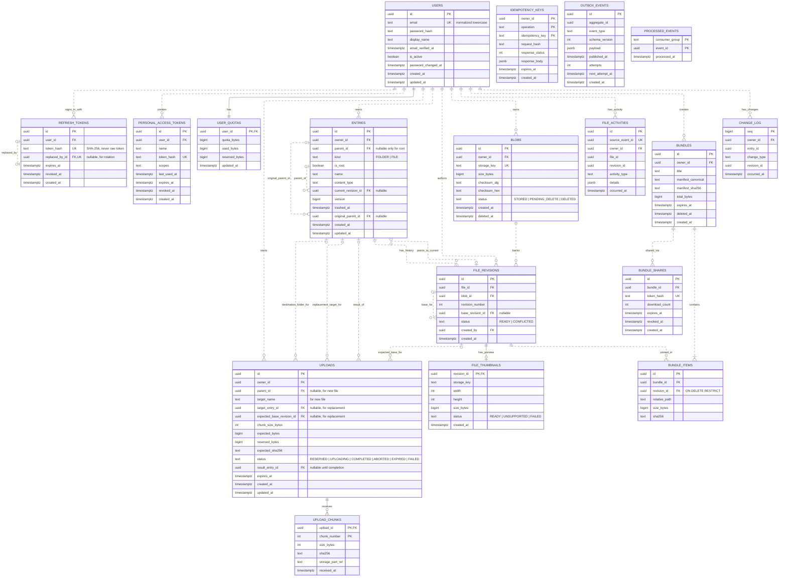

## Database tables

### Accounts and access

| Table | Purpose |
|---|---|
| `USERS` | Stores user accounts, profile details, and password hashes. |
| `USER_QUOTAS` | Tracks each user’s storage limit, bytes used, and bytes reserved for uploads. |
| `REFRESH_TOKENS` | Stores refresh-token hashes and tracks rotation and revocation for login sessions. |
| `PERSONAL_ACCESS_TOKENS` | Stores token hashes, scopes, and expiry for revocable CLI and script access. |

### Files and uploads

| Table | Purpose |
|---|---|
| `ENTRIES` | Represents files and folders in the drive. Each file entry points to its current revision. |
| `FILE_REVISIONS` | Records saved versions of a file, including edits saved as conflicts. |
| `BLOBS` | Stores the location, size, and checksum of file contents kept on disk or in object storage. |
| `UPLOADS` | Tracks an upload’s destination, status, and expiry. |
| `UPLOAD_CHUNKS` | Records which parts arrived so an interrupted upload can resume by sending the missing parts. |
| `IDEMPOTENCY_KEYS` | Records the outcome of a request so a retry can return the same result without repeating the action. |

### Delivery bundles

| Table | Purpose |
|---|---|
| `BUNDLES` | Represents a delivery and stores its title, manifest, and expiry. |
| `BUNDLE_ITEMS` | Pins the exact revision and ZIP path of each file in a delivery. |
| `BUNDLE_SHARES` | Stores hashed download tokens so each link can expire or be revoked independently. |

### Background processing and sync

| Table | Purpose |
|---|---|
| `OUTBOX_EVENTS` | Records events in the same database transaction as the change that produced them, ready for later publication to Kafka. |
| `PROCESSED_EVENTS` | Records which events each consumer has handled so a redelivered event can be recognized. |
| `FILE_THUMBNAILS` | Tracks the preview image and generation status for each file revision. |
| `FILE_ACTIVITIES` | Stores the timeline users see, such as “Uploaded `photo.jpg`.” |
| `CHANGE_LOG` | Tells sync clients which drive items changed since their last check, including renames, replacements, and deletions. |

