## Database tables

### Accounts and access

| Table | Purpose | Phase |
|---|---|---|
| `USERS` | Stores user accounts, profile details, and password hashes. `password_hash` is empty for Google-only users. | 1 |
| `OAUTH_ACCOUNTS` | Links a user to an external login (Google) by the provider's stable user ID, never by email. | 1 |
| `SPRING_SESSION` | Server-side browser sessions (one row per logged-in browser). Owned by Spring Session JDBC; you don't write to it directly. | 1 |
| `SPRING_SESSION_ATTRIBUTES` | The data stored in each session, such as the security context and login time. | 1 |
| `EMAIL_TOKENS` | Stores hashed one-time tokens for email verification and password reset. | 7 |
| `PERSONAL_ACCESS_TOKENS` | Stores token hashes, scopes, and expiry for revocable CLI and script access. | 5 |
| `USER_QUOTAS` | Per-user counters: storage limit, bytes used, bytes reserved for uploads, and the last change-feed number. | 1 |

### Files and uploads

| Table | Purpose | Phase |
|---|---|---|
| `ENTRIES` | Represents files and folders in the drive, including trash state. Each file entry points to its current revision. | 1 |
| `FILE_REVISIONS` | Records saved versions of a file, including edits saved as conflicts. | 1 |
| `BLOBS` | Stores the location, size, and checksum of file contents kept on disk or in object storage. | 1 |
| `UPLOADS` | Tracks an upload's destination, status, reserved quota, and expiry. | 1 |
| `UPLOAD_CHUNKS` | Records which parts arrived so an interrupted upload can resume by sending the missing parts. | 2 |
| `IDEMPOTENCY_KEYS` | Records the outcome of a request so a retry can return the same result without repeating the action. | 2 |

### Delivery bundles

| Table | Purpose | Phase |
|---|---|---|
| `BUNDLES` | Represents a delivery and stores its title, manifest, and expiry. | 4 |
| `BUNDLE_ITEMS` | Pins the exact revision and ZIP path of each file in a delivery. | 4 |
| `BUNDLE_SHARES` | Stores hashed download tokens so each link can expire or be revoked independently. | 4 |
| `BUNDLE_DOWNLOADS` | Download receipts: when a recipient started and finished downloading, and how many bytes were sent. | 4 |

### Background processing and sync

| Table | Purpose | Phase |
|---|---|---|
| `OUTBOX_EVENTS` | Records events in the same database transaction as the change that produced them, ready for the in-process dispatcher to deliver to handlers. | 3 |
| `PROCESSED_EVENTS` | Records which events each handler has processed, so a redelivered event is recognized and skipped. | 3 |
| `FILE_THUMBNAILS` | Tracks the preview image and generation status for each file revision. | 3 |
| `FILE_ACTIVITIES` | Stores the timeline users see, such as "Uploaded `photo.jpg`." | 3 |
| `CHANGE_LOG` | Tells sync clients which drive items changed since their last check, numbered per owner. | 5 |

There is no token table for the browser: the session cookie authenticates every request, including plain download links. The only bearer tokens are CLI tokens (`PERSONAL_ACCESS_TOKENS`) and bundle share links (`BUNDLE_SHARES`).

```mermaid
---
config:
  layout: elk
  elk:
    mergeEdges: false
---
erDiagram
    USERS ||..o{ OAUTH_ACCOUNTS : signs_in_with
    USERS ||..o{ SPRING_SESSION : "logged in as (PRINCIPAL_NAME, no FK)"
    SPRING_SESSION ||--o{ SPRING_SESSION_ATTRIBUTES : stores
    USERS ||..o{ EMAIL_TOKENS : verifies_with
    USERS ||..o{ PERSONAL_ACCESS_TOKENS : creates
    USERS ||--|| USER_QUOTAS : has
    USERS ||..o{ ENTRIES : owns
    USERS ||..o{ BLOBS : owns
    USERS ||..o{ UPLOADS : starts
    USERS ||..o{ FILE_REVISIONS : authors
    USERS ||..o{ FILE_ACTIVITIES : has_activity
    USERS ||..o{ BUNDLES : creates
    USERS ||..o{ CHANGE_LOG : has_changes

    ENTRIES o|..o{ ENTRIES : parent_of
    ENTRIES o|..o{ ENTRIES : original_parent_of
    ENTRIES ||..o{ FILE_REVISIONS : has_history
    ENTRIES }o..o| FILE_REVISIONS : points_to_current
    FILE_REVISIONS o|..o{ FILE_REVISIONS : base_for
    BLOBS ||..o{ FILE_REVISIONS : backs
    FILE_REVISIONS ||--o| FILE_THUMBNAILS : has_preview

    ENTRIES o|..o{ UPLOADS : destination_folder_for
    ENTRIES o|..o{ UPLOADS : replacement_target_for
    ENTRIES o|..o{ UPLOADS : result_of
    FILE_REVISIONS o|..o{ UPLOADS : expected_base_for
    FILE_REVISIONS o|..o{ UPLOADS : result_revision_of
    UPLOADS ||--o{ UPLOAD_CHUNKS : receives

    BUNDLES ||..|{ BUNDLE_ITEMS : contains
    FILE_REVISIONS ||..o{ BUNDLE_ITEMS : pinned_in
    BUNDLES ||..o{ BUNDLE_SHARES : shared_via
    BUNDLE_SHARES ||..o{ BUNDLE_DOWNLOADS : records

    USERS {
        uuid id PK
        text email UK "trimmed lowercase, CHECK"
        text password_hash "nullable: Google-only users"
        text display_name
        timestamptz email_verified_at
        boolean is_active
        timestamptz password_changed_at
        timestamptz created_at
        timestamptz updated_at
    }

    OAUTH_ACCOUNTS {
        uuid id PK
        uuid user_id FK
        text provider "google"
        text provider_user_id "Google sub claim, never the email"
        text email_at_link
        timestamptz created_at
        timestamptz last_login_at
    }

    SPRING_SESSION {
        char(36) PRIMARY_ID PK
        char(36) SESSION_ID UK "value of the SESSION cookie"
        bigint CREATION_TIME "epoch ms"
        bigint LAST_ACCESS_TIME "epoch ms"
        int MAX_INACTIVE_INTERVAL "seconds"
        bigint EXPIRY_TIME "indexed, for cleanup"
        varchar(100) PRINCIPAL_NAME "users.id as text, indexed"
    }

    SPRING_SESSION_ATTRIBUTES {
        char(36) SESSION_PRIMARY_ID PK, FK "ON DELETE CASCADE"
        varchar(200) ATTRIBUTE_NAME PK
        bytea ATTRIBUTE_BYTES
    }

    EMAIL_TOKENS {
        uuid id PK
        uuid user_id FK
        text purpose "VERIFY_EMAIL | RESET_PASSWORD"
        text token_hash UK
        timestamptz expires_at
        timestamptz used_at
        timestamptz created_at
    }

    PERSONAL_ACCESS_TOKENS {
        uuid id PK
        uuid user_id FK
        text name
        text token_prefix "shown in UI, e.g. fbx_pat_ab12"
        text token_hash UK
        text[] scopes
        timestamptz last_used_at
        timestamptz expires_at
        timestamptz revoked_at
        timestamptz created_at
    }

    USER_QUOTAS {
        uuid user_id PK, FK
        bigint quota_bytes
        bigint used_bytes
        bigint reserved_bytes
        bigint change_seq "last CHANGE_LOG seq for this owner"
        timestamptz updated_at
    }

    BLOBS {
        uuid id PK
        uuid owner_id FK
        text storage_key UK
        bigint size_bytes
        text checksum_alg
        text checksum_hex
        text status "STORED | PENDING_DELETE | DELETED"
        timestamptz created_at
        timestamptz deleted_at
    }

    ENTRIES {
        uuid id PK
        uuid owner_id FK
        uuid parent_id FK "null only for root"
        text kind "FOLDER | FILE"
        boolean is_root
        text name
        text name_key "generated: lower(normalize(name, NFC))"
        uuid current_revision_id FK "nullable"
        bigint version "optimistic lock for rename and move"
        timestamptz trashed_at
        uuid original_parent_id FK "nullable"
        timestamptz created_at
        timestamptz updated_at
    }

    FILE_REVISIONS {
        uuid id PK
        uuid file_id FK
        uuid blob_id FK
        int revision_number
        uuid base_revision_id FK "nullable"
        text content_type
        text status "READY | CONFLICTED"
        uuid created_by FK
        timestamptz created_at
    }

    UPLOADS {
        uuid id PK
        uuid owner_id FK
        uuid parent_id FK "nullable, for new file"
        text target_name "for new file"
        uuid target_entry_id FK "nullable, for replacement"
        uuid expected_base_revision_id FK "nullable, for replacement"
        text content_type
        int chunk_size_bytes
        bigint expected_bytes
        bigint reserved_bytes
        text expected_sha256
        text storage_upload_ref "S3 multipart UploadId, null on local disk"
        text status "RESERVED | UPLOADING | VERIFYING | COMPLETED | ABORTED | EXPIRED | FAILED"
        uuid result_entry_id FK "nullable until completion"
        uuid result_revision_id FK "nullable until completion"
        timestamptz expires_at
        timestamptz created_at
        timestamptz updated_at
    }

    UPLOAD_CHUNKS {
        uuid upload_id PK, FK
        int chunk_number PK
        int size_bytes
        text sha256
        text storage_part_ref "S3 part ETag or local part path"
        timestamptz received_at
    }

    IDEMPOTENCY_KEYS {
        uuid owner_id PK
        text operation PK
        text idempotency_key PK
        text request_hash
        text status "IN_PROGRESS | COMPLETED"
        int response_status "nullable while IN_PROGRESS"
        jsonb response_body
        timestamptz expires_at
        timestamptz created_at
    }

    OUTBOX_EVENTS {
        uuid id PK
        text aggregate_type
        uuid aggregate_id "ordering key, e.g. file ID"
        text event_type
        int schema_version
        jsonb payload
        jsonb headers "request ID, trace context"
        int attempts
        timestamptz next_attempt_at
        text last_error
        timestamptz published_at
        timestamptz dead_at "gave up after N attempts"
        timestamptz created_at
    }

    PROCESSED_EVENTS {
        text handler PK "thumbnails | activity | search-index"
        uuid event_id PK
        timestamptz processed_at
    }

    FILE_THUMBNAILS {
        uuid revision_id PK, FK
        text storage_key
        int width
        int height
        bigint size_bytes
        text status "READY | UNSUPPORTED | FAILED"
        timestamptz created_at
    }

    FILE_ACTIVITIES {
        uuid id PK
        uuid source_event_id UK
        uuid owner_id FK
        uuid file_id
        uuid revision_id
        text activity_type
        jsonb details
        timestamptz occurred_at
    }

    BUNDLES {
        uuid id PK
        uuid owner_id FK
        text title
        text manifest_canonical
        text manifest_sha256
        bigint total_bytes
        timestamptz expires_at
        timestamptz deleted_at
        timestamptz created_at
    }

    BUNDLE_ITEMS {
        uuid id PK
        uuid bundle_id FK
        uuid revision_id FK "ON DELETE RESTRICT"
        text relative_path
        bigint size_bytes
        text sha256
    }

    BUNDLE_SHARES {
        uuid id PK
        uuid bundle_id FK
        text token_hash UK
        int download_count
        int max_downloads "nullable"
        timestamptz expires_at
        timestamptz revoked_at
        timestamptz created_at
    }

    BUNDLE_DOWNLOADS {
        uuid id PK
        uuid share_id FK
        timestamptz started_at
        timestamptz completed_at "null if the download broke off"
        bigint bytes_sent
        text client_ip_hash "hashed, not the raw IP"
        text user_agent
    }

    CHANGE_LOG {
        uuid owner_id PK, FK
        bigint seq PK "from USER_QUOTAS.change_seq"
        uuid entry_id
        text change_type
        uuid revision_id
        timestamptz occurred_at
    }
```

